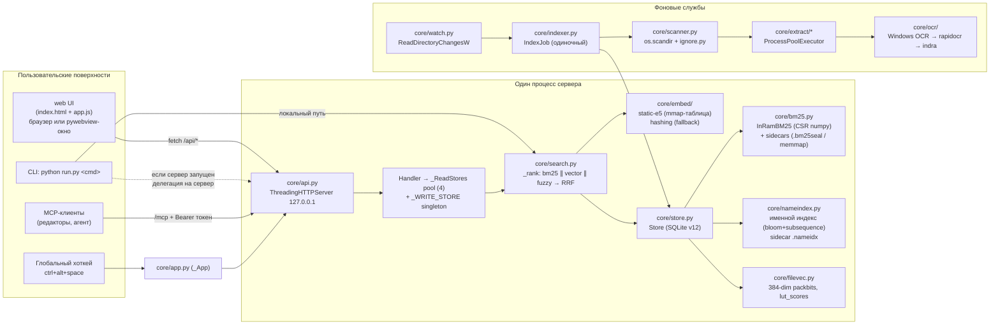
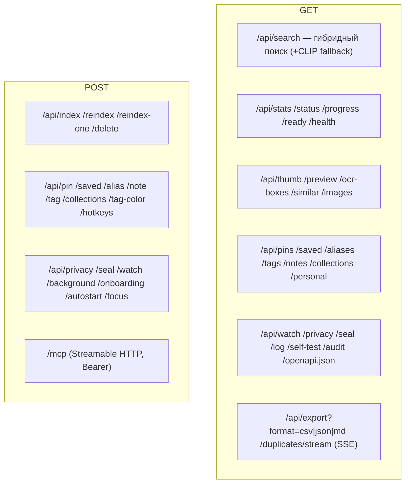
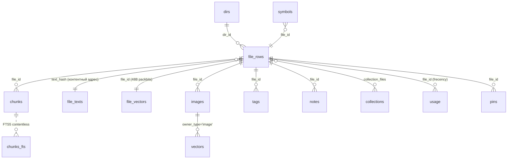
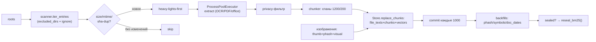

# PROJECT_MAP.md — карта проекта AutoFind

> Построена по результатам полного read-only исследования (ЭТАП 1) и профилирования на реальном
> индексе (`~/.autofind`, 21 643 файла, 313 041 чанк, схема v12). Все связи проверены по исходникам;
> неподтверждённое помечено `UNKNOWN`.

## 1. Что это

AutoFind — локальный поисковый движок по файлам и скриншотам на Python (Windows-first),
конкурент Rust-приложения kensaku. Гибридный поиск: нечёткий поиск по именам + BM25 + векторы,
фьюжн через RRF. Один SQLite-файл индекса в WAL-режиме + sidecar-файлы.

**Стек:** Python ≥3.11, stdlib (ThreadingHTTPServer — без FastAPI), SQLite (FTS5), numpy, Pillow,
опционально: PyMuPDF, ONNX Runtime (e5/CLIP/OCR), pywebview/pystray/pynput (десктоп), cryptography
(AES-256-GCM), rapidocr/winrt (OCR), tokenizers (статические эмбеддинги). Сборка — PyInstaller.

## 2. Общая архитектура



## 3. Структура папок

| Путь | Назначение |
|---|---|
| `run.py` | Лаунчер + диспетчер CLI/приложения |
| `core/cli.py` | ~50 подкоманд CLI (index/search/serve/seal/backup/…) |
| `core/api.py` | HTTP-сервер, ~60 маршрутов, пул read-Store, write-Store |
| `core/search.py` | Гибридный поиск: 3 канала + RRF + бонусы kensaku |
| `core/store.py` | SQLite v12, file_texts (контентно-адресованные блобы), sealed-режим, sidecars |
| `core/bm25.py` | InRamBM25 — CSR-постинги numpy |
| `core/nameindex.py` | Именной индекс: bloom-префильтр, fzf-подобный скоринг, sidecar `.nameidx` |
| `core/filevec.py` | 48-байтовые packbits-векторы файлов, LUT-скоринг |
| `core/vectors.py` | Пак-бэкенд `.v4.vec` (с v9 фактически мёртв, см. аудит) |
| `core/indexer.py` | Конвейер индексации, ProcessPoolExecutor, heavy-lights-first |
| `core/scanner.py`, `core/ignore.py` | Обход диска, .gitignore-совместимые правила |
| `core/extract/` | Извлечение текста: plain/pdf/docx/office/delimited/archive/email/msg/dates |
| `core/ocr/` | 3 яруса OCR + indra (порт OCR kensaku) |
| `core/images.py` | Препроцессинг, миниатюры 320px, визуальные дескрипторы, phash |
| `core/chunker.py` | Нормализация + чанки (start,len)-спанами в единый текст документа |
| `core/privacy.py` | 7 категорий приватности (пути), фильтр до открытия файла |
| `core/vault.py` | AES-256-GCM, DPAPI или Argon2id/scrypt, режим seal |
| `core/query.py` | Парсер запроса: фильтры, CJK, regex, символы |
| `core/cjk.py` | Биграммы CJK для FTS и BM25 |
| `core/group.py` | Группировка версий документов и всплесков скриншотов |
| `core/personal.py` | Пины / сохранённые запросы / алиасы |
| `core/symbols.py` | Определения функций/классов regex-ами (без tree-sitter) |
| `core/watch.py`, `idle.py`, `lifespan.py` | Вотчер, idle-гейт, политика батареи |
| `core/mcp.py`, `connect.py`, `openapi.py` | MCP over stdio+HTTP, регистрация клиентов, OpenAPI-таблица |
| `core/memguard.py`, `maintenance.py`, `doctor.py`, `updater.py`, `transfer.py` | RAM-лимит, обслуживание, самопроверка, обновления, ZIP-перенос |
| `web/` | Фронтенд: index.html (961), app.js (3158), style.css (2020), i18n.js (1671), fon.jpg (95KB) |
| `tests/` | 48 тест-файлов, unittest discover |
| `tools/` | Дистилляция статических эмбеддингов, CLIP, иконки, coldstart-замеры |
| `docs/`, `BENCH.md`, `README*.md` | Документация и бенчмарки |

## 4. Карта API (основные маршруты, полный список в core/api.py)



- Авторизация: bind 127.0.0.1 + проверка Host/Origin. REST **без токена** (осознанно);
  `/mcp` — Bearer из `<home>/mcp_token`.
- Threading: поток на запрос; read-Store из пула (≤4), запись через один write-Store;
  индексация — одиночный IndexJob; MemGuard сбрасывает кэши по RAM-лимиту.

## 5. Карта базы данных (schema v12)



Ключевые таблицы: `dirs`(path UNIQUE), `file_rows`(basename+dir, char_mask, sha256, kind, mtime,
size, text_hash; индексы text_hash/mtime/size), `file_texts`(hash PK, zlib-блоки + offsets),
`chunks`(file_id, ord, start, len — спаны), `file_vectors`, `images`(thumb BLOB, ocr_text, phash),
`vectors`(int8+scale), `symbols`, `meta`, `recent_searches`, `pins/saved/aliases/tags/notes/
collections/tag_colors/usage`.

PRAGMA: `mmap_size=1GB`(writer)/0(ro), `cache_size` по роли, `journal_mode=WAL`,
`synchronous=NORMAL`, `busy_timeout=5000`, `wal_checkpoint(TRUNCATE)` на compact/close.

## 6. Поток данных поиска (горячий путь)

```mermaid
sequenceDiagram
    participant U as Пользователь
    participant F as web/app.js
    participant A as api.py Handler
    participant R as search._rank
    participant B as InRamBM25 (.bm25seal)
    participant N as nameindex (.nameidx)
    participant V as filevec lut_scores
    participant D as SQLite file_texts→chunks
    U->>F: ввод запроса
    F->>A: GET /api/search?q=…
    A->>R: search_page(store, embedder, q)
    par каналы параллельно
        R->>B: lexical (bm25_text, pool)
        R->>N: fuzzy_files (bloom+subsequence)
    end
    R->>V: encode_query → knn (gated для не-семантических эмбеддеров)
    R->>D: chunk_rows (сниппеты; для sealed — AES-GCM+zlib)
    R->>R: RRF-фьюжн + бонусы (имя/recency/frecency/pin/depth)
    R->>D: sha256_for → group_hits (версии/бёрсты)
    R-->>A: SearchPage(hits, facets, chips, hints)
    A-->>F: JSON
    F-->>U: таблица результатов
```

## 7. Поток данных индексации



## 8. Безопасность

- **HTTP**: только 127.0.0.1, Host/Origin; REST без токена (локальная модель угроз),
  `/mcp` — Bearer `mcp_token` (token_urlsafe(32), chmod 0600).
- **Seal (paranoid)**: AES-256-GCM (AFS1-блобы) над file_texts/ocr/thumb/symbols; FTS удаляется
  с диска; контентный поиск живёт через зашифрованный sidecar `.bm25seal`; ключ — DPAPI
  (`vault.key`, AFVK1) или passphrase (AFVK2, Argon2id/scrypt). Без ключа чтение падает с
  внятной ошибкой.
- **Приватность**: 7 категорий путей до открытия файла.
- **Обновления**: https-only + SHA256SUMS + лимит размера.
- Аудит `/api/audit` реализован целиком (`api.py:754-755,1052-1111`), включая `files`-view и `store_sealed`; пометка UNKNOWN снята.

## 9. Сборка/запуск/тесты

- Запуск из исходников: `python run.py` (окно) / `python run.py search …` (CLI) / `python run.py serve`.
- Из сборки: `dist/AutoFind/AutoFind.exe` (PyInstaller one-folder, console=False).
- CI: `.github/workflows/tests.yml` — unittest на windows-latest (3.11–3.13) + ubuntu smoke.
  Локально: `python -m unittest discover -s tests -t . -v` (pytest тоже работает).
- `pyproject.toml`: скрипт `autofind = core.cli:main`; extras: pdf/docx/onnx/watch/dev.

## 10. Основные пользовательские сценарии

1. **Мгновенный поиск** (хоткей/окно) → /api/search → гибридный рейтинг → группировка версий/бёрстов → открытие файла.
2. **Первый запуск**: onboarding → выбор папок → первая индексация (батарея/idle-гейты).
3. **Фоновая актуализация**: ReadDirectoryChangesW → отложенная доиндексация.
4. **Параноидальный режим**: seal → всё контентное шифруется, FTS падает, только .bm25seal.
5. **Переезд с kensaku**: `import kensaku` → пины/запросы/словарь переносятся.
6. **MCP-интеграция**: редактор подключается через `connect` → 6 read-only инструментов.
