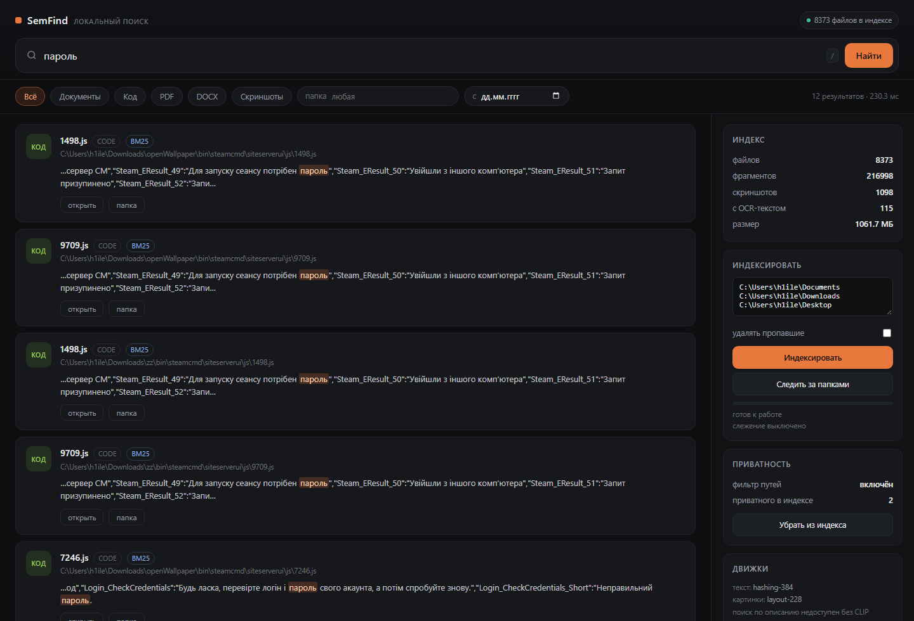

# SemFind

Local search over your files and screenshots. One SQLite file, no account, no
network calls at runtime.



## Status

All four layers of the plan are implemented and run on a stock Windows machine
with no model downloads:

| Layer | State | Engine |
|---|---|---|
| Text (PDF, DOCX, TXT/MD, code) | works | built-in extractors, no deps |
| Screenshots: OCR | works | Windows OCR via WinRT (`ru` + `en` on this machine) |
| Screenshots: visual similarity | works | 228-dim layout/colour descriptor |
| Search | works | BM25 + vectors, fused with RRF |
| Live updates | works | polling watcher, ~2 s debounce |
| Quality measurement | works | `eval` with Recall@10, MRR, ablation |
| Privacy filter | works | path blocklist, `privacy purge` |
| UI | works | local web app on 127.0.0.1 |

Two upgrades are drop-in and change nothing else: `multilingual-e5-small` for
semantic text vectors, and `CLIP ViT-B/32` for text-to-image search. Until they
are present the text embedder is lexical (words + character 4-grams) and image
search is similarity-only, and the UI says so instead of pretending.

## Quick start

```bat
SemFind.bat
```

or

```bash
python run.py                 # opens http://127.0.0.1:8765
```

The sidebar lists the folders worth indexing (Documents, Downloads, Desktop,
Screenshots) — one click indexes them, progress is live, and results appear as
files are added.

Command line:

```bash
python -m core.cli index ~/Documents ~/Downloads ~/Pictures/Screenshots --prune
python -m core.cli watch ~/Documents ~/Downloads          # keep the index in sync
python -m core.cli search "неверный пароль при входе"
python -m core.cli search "cannot find module" --kind image
python -m core.cli eval tests/queries/labels_demo.json --ablate --verbose
python -m core.cli doctor                                  # environment + bundle budget
python -m core.cli privacy                                 # what the filter would skip
python -m core.cli privacy purge                           # drop it from the index
python -m core.cli stats
```

## How it works

```
files ──► extractors ──┐
                       ├──► chunker ──► text embedder ──┐
screenshots ──► OCR ───┘                                ├──► index.db
                                                        │    FTS5 + vectors
screenshots ──► visual descriptor ──────────────────────┘
                                                             │
                                            BM25 ─┐          │
                                                  ├─► RRF ───┘
                                            KNN  ─┘
```

Screenshots land in the same `chunks` table as documents, so one query returns
a PDF and a screenshot side by side. Each screenshot also gets a thumbnail and
a visual vector, which powers "similar screenshots" in the UI.

**Storage.** One SQLite file in WAL mode: `files`, `chunks`, `chunks_fts`
(FTS5), `images`, `vectors`, `meta`. Vectors are float32 blobs searched by
brute force in numpy — at 50k chunks that is a 77 MB matrix and single-digit
milliseconds, so an ANN index would be premature. `sqlite-vec` can replace
`Store.knn()` without touching callers.

**Indexing is incremental.** Unchanged files are skipped by size+mtime, moved
files by sha256. Screenshots are deduplicated by sha256 before OCR runs.

**Live updates** (`watch`) poll the roots every 2 s instead of using inotify or
ReadDirectoryChanges: one stat per file is cheap, and polling survives network
shares and cloud-synced folders where native notifications are unreliable. A
file is read only after it has been quiet for a second, so a document being
saved is indexed once at the end. On start the watcher also drops index entries
whose files no longer exist — otherwise a file deleted while the app was closed
would stay searchable forever.

## Measured on this machine

Windows 11, Python 3.13, 4 cores, hashed-feature text embedder, Windows OCR:

| Corpus | Files | Chunks | Index time | Query (warm) |
|---|---|---|---|---|
| 6 screenshots + plan document + this repo | 36 | 174 | 0.7 s | 7–10 ms |
| Synthetic 1000-file mix (txt/py/docx) | 1 000 | 1 000 | 1.1 s | 8 ms |
| Real `~/Downloads` tree (Blender, SteamCMD, projects) | 8 373 | 216 998 | ~14 min | 21 ms |

OCR costs about **86 ms per screenshot** including preprocessing (6 screenshots
in 0.5 s). The 1 000-file run is 881 files/s against the plan's 10-minute
target, but that corpus is 1.5 MB total with one chunk per file — PDF-heavy
folders will be an order of magnitude slower, because extraction, not embedding,
is the bottleneck.

Two numbers the plan should have known:

- **First query after a restart costs 2.6 s** on the 217k-chunk index: the
  vector matrix (333 MB) is read from SQLite and stacked. It is cached per
  process afterwards (21 ms), and the UI server pre-warms it at startup. This is
  exactly the point where `sqlite-vec` stops being optional.
- **The index is 1.06 GB for 8.4k files.** Most of it is the float32 matrix, not
  text. Deduplicating identical chunks across the tree would cut it substantially.

## Quality

`semfind eval` scores a labelled query set. On the 14-query smoke set over the
8.4k-file corpus:

| Channel | Recall@10 | MRR | p95 |
|---|---|---|---|
| BM25 only | 0.714 | 0.620 | 22 ms |
| Vector only (hashing fallback) | 0.071 | 0.073 | 39 ms |
| Fused (shipped default) | 0.714 | 0.620 | 59 ms |

Read this as a diagnosis, not a score. With the fallback embedder the vector
channel adds nothing and, at equal weight, actively hurt (0.643 recall before
damping). Two changes came out of the measurement: the vector weight now comes
from the embedder itself (0.3 for the hashed fallback, 1.0 for a semantic
model), and a query with no lexical match returns nothing instead of hash
collisions. The remaining misses are all paraphrases — «ошибка сборки» for a
screenshot that says `Error: cannot find module` — which is precisely what e5 is
for, and exactly what this build cannot do.

The 20-query acceptance set from the plan is in `tests/queries/queries.json`;
labels are still placeholders. Recall@10 ≥ 0.7 stays unproven until someone runs
it on a real corpus with answers written by a second person.

## OCR notes

The Windows recogniser ships with the OS and knows Russian if the language pack
is installed — no Tesseract binary, no 20 MB of traineddata, no install step.

Preprocessing is engine-specific, and this was measured rather than assumed:
feeding a dark screenshot through grayscale + autocontrast **lowers** the
Windows engine's output (136 vs 162 characters on the same image), because it
handles dark themes natively. So it gets the image as-is plus an upscale for
small text; only Tesseract gets the grayscale-and-invert treatment.

Engine order: `windows-ocr` → `tesseract-cli` → `pytesseract` → `rapidocr`.
The engine that produced a screenshot's text is recorded in the index, so a
later switch is visible instead of silent.

## Embedders

| Role | Default | Upgrade |
|---|---|---|
| Text | `hashing-384` (words + char 4-grams) | `e5-small` int8 ONNX |
| Visual | `layout-228` (colour, layout, edges) | `CLIP ViT-B/32` int8 ONNX |

Drop weights in and restart:

```
~/.semfind/models/e5-small/model.onnx + tokenizer.json
~/.semfind/models/clip/visual.onnx + textual.onnx + tokenizer.json
```

`pip install 'semfind[onnx]'` adds the runtime. The index records which embedder
built it and refuses to mix two, so switching means reindexing — deliberate, not
an oversight.

## Bundle budget

`semfind doctor` adds up what would actually ship:

```
bundle       378.0 MB of 150 MB budget  over by 228.0 MB
  python-embed                  15.0 MB   runtime
  numpy                         18.0 MB   runtime
  pillow                         4.0 MB   runtime
  winrt bindings                 3.0 MB   runtime
  onnxruntime                   50.0 MB   optional: only with e5/CLIP
  app code + web                 1.0 MB   runtime
  model:e5-small               120.0 MB   download or bundle
  model:clip-vit-b32            45.0 MB   download or bundle
  model:tesseract-rus-eng       22.0 MB   download or bundle
  model:argos-ru-en            100.0 MB   download or bundle
```

The plan's ≤150 MB installer cannot hold e5 + CLIP + Argos. Dropping Argos
(Russian queries would then need a multilingual CLIP export, or text-to-image
search stays English-only) saves 100 MB and still leaves 278 MB. The realistic
split is a ~60 MB shell plus models downloaded on first run, or a hard choice
between semantic text and text-to-image.

## Privacy

Two separate promises, and the second one was missing:

1. **Nothing leaves the machine.** No network calls at runtime; the HTTP server
   binds to 127.0.0.1 and rejects foreign Host headers.
2. **Some things never enter the index.** `core/privacy.py` drops password
   stores, key material, browser profile data and cloud-credential folders
   *before* any file is opened: `.ssh`, `*.kdbx`, `wallet.dat`, Chrome/Edge
   profile directories, `*.env`, `*password*`-style names. Source files are
   exempt from the broad name globs — Blender ships `secrets.py`, and indexing a
   standard-library module is not an incident.

The filter is on by default, its count appears in `index` output and in the UI,
and `semfind privacy purge` removes what slipped in earlier. On this machine it
found two «Пароль на архив» files that predate the filter.

Still missing: **the index is not encrypted**. Filtered paths are skipped, but
everything else — including OCR text of your entire screen — sits in a plain
SQLite file. An app-level blocklist, a pause switch and SQLCipher are open items.

## Tests

```bash
python -m unittest discover -s tests -t .
```

28 tests: chunking, kind detection, DOCX/PDF extraction, image preprocessing,
visual features, thumbnails, real OCR (skipped when no engine), FTS query
sanitising, the full index→search cycle, kind filters, incremental skips,
screenshot dedup, similar-image search, the privacy blocklist, watcher diffing
and startup cleanup, the eval metrics and the bundle estimate.

`tests/queries/queries.json` holds the fixed 20-query acceptance set from the
plan. Expected answers are still placeholders — attaching a real corpus is what
turns Recall@10 from a claim into a number.

## Not done yet

- `CLIP` and `e5` weights are not bundled; the installer budget is 378 MB
  against the plan's 150 MB, and that decision is still open.
- Index encryption, an app blocklist and a global OCR pause switch.
- `sqlite-vec` — brute force is fine at 21 ms warm, but the 2.6 s cold load and
  333 MB matrix are the reason to move.
- Tauri shell, global hotkey, MSI/DMG/AppImage packaging.
- The document itself still has the inconsistencies listed in the review
  (top-10 table vs figure, p95 vs median, 30 Nov vs 29 Nov).

## License

MIT.
