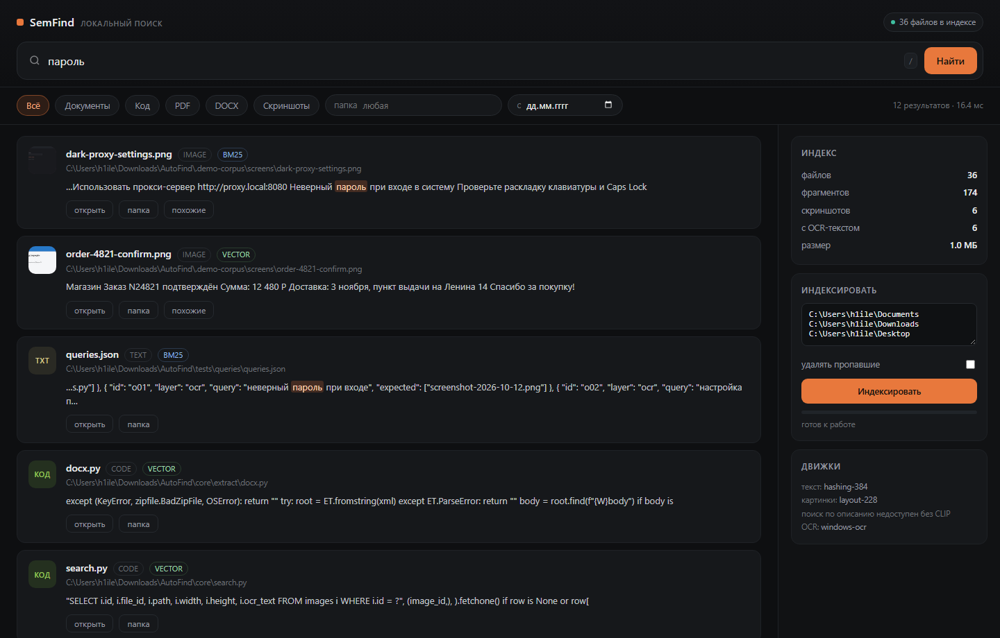

# SemFind

Local search over your files and screenshots. One SQLite file, no account, no
network calls at runtime.



## Status

All four layers of the plan are implemented and run on a stock Windows machine
with no model downloads:

| Layer | State | Engine |
|---|---|---|
| Text (PDF, DOCX, TXT/MD, code) | works | built-in extractors, no deps |
| Screenshots: OCR | works | Windows OCR via WinRT (`ru` + `en` on this machine) |
| Screenshots: visual similarity | works | 228-dim layout/colour descriptor |
| Search | works | BM25 + vectors, fused with RRF |
| UI | works | local web app on 127.0.0.1 |

Two upgrades are drop-in and change nothing else: `multilingual-e5-small` for
semantic text vectors, and `CLIP ViT-B/32` for text-to-image search. Until they
are present the text embedder is lexical (words + character 4-grams) and image
search is similarity-only, and the UI says so instead of pretending.

## Quick start

```bat
SemFind.bat
```

or

```bash
python run.py                 # opens http://127.0.0.1:8765
```

The sidebar lists the folders worth indexing (Documents, Downloads, Desktop,
Screenshots) — one click indexes them, progress is live, and results appear as
files are added.

Command line:

```bash
python -m core.cli index ~/Documents ~/Downloads ~/Pictures/Screenshots --prune
python -m core.cli search "неверный пароль при входе"
python -m core.cli search "cannot find module" --kind image
python -m core.cli stats
```

## How it works

```
files ──► extractors ──┐
                       ├──► chunker ──► text embedder ──┐
screenshots ──► OCR ───┘                                ├──► index.db
                                                        │    FTS5 + vectors
screenshots ──► visual descriptor ──────────────────────┘
                                                             │
                                            BM25 ─┐          │
                                                  ├─► RRF ───┘
                                            KNN  ─┘
```

Screenshots land in the same `chunks` table as documents, so one query returns
a PDF and a screenshot side by side. Each screenshot also gets a thumbnail and
a visual vector, which powers "similar screenshots" in the UI.

**Storage.** One SQLite file in WAL mode: `files`, `chunks`, `chunks_fts`
(FTS5), `images`, `vectors`, `meta`. Vectors are float32 blobs searched by
brute force in numpy — at 50k chunks that is a 77 MB matrix and single-digit
milliseconds, so an ANN index would be premature. `sqlite-vec` can replace
`Store.knn()` without touching callers.

**Indexing is incremental.** Unchanged files are skipped by size+mtime, moved
files by sha256. Screenshots are deduplicated by sha256 before OCR runs.

## Measured on this machine

Windows 11, Python 3.13, 4 cores, hashed-feature text embedder, Windows OCR:

| Corpus | Files | Chunks | Index time | Query |
|---|---|---|---|---|
| 6 screenshots + plan document + this repo | 36 | 174 | 0.7 s | 7–10 ms |
| Synthetic 1000-file mix (txt/py/docx) | 1 000 | 1 000 | 1.1 s | 8 ms |

OCR costs about **86 ms per screenshot** including preprocessing (6 screenshots
in 0.5 s). The 1 000-file run is 881 files/s against the plan's 10-minute
target, but that corpus is 1.5 MB total with one chunk per file — PDF-heavy
folders will be an order of magnitude slower, because extraction, not embedding,
is the bottleneck.

## OCR notes

The Windows recogniser ships with the OS and knows Russian if the language pack
is installed — no Tesseract binary, no 20 MB of traineddata, no install step.

Preprocessing is engine-specific, and this was measured rather than assumed:
feeding a dark screenshot through grayscale + autocontrast **lowers** the
Windows engine's output (136 vs 162 characters on the same image), because it
handles dark themes natively. So it gets the image as-is plus an upscale for
small text; only Tesseract gets the grayscale-and-invert treatment.

Engine order: `windows-ocr` → `tesseract-cli` → `pytesseract` → `rapidocr`.
The engine that produced a screenshot's text is recorded in the index, so a
later switch is visible instead of silent.

## Embedders

| Role | Default | Upgrade |
|---|---|---|
| Text | `hashing-384` (words + char 4-grams) | `e5-small` int8 ONNX |
| Visual | `layout-228` (colour, layout, edges) | `CLIP ViT-B/32` int8 ONNX |

Drop weights in and restart:

```
~/.semfind/models/e5-small/model.onnx + tokenizer.json
~/.semfind/models/clip/visual.onnx + textual.onnx + tokenizer.json
```

`pip install 'semfind[onnx]'` adds the runtime. The index records which embedder
built it and refuses to mix two, so switching means reindexing — deliberate, not
an oversight.

## Privacy

The index is a plain SQLite file in your profile. Nothing is uploaded, nothing
is fetched at runtime, and the HTTP server binds to 127.0.0.1 with a Host-header
check. But: **the index is not encrypted**, and OCR text of your screen is
exactly the kind of data you would not want in a plain file. An app blocklist,
a pause switch and SQLCipher are open items, not done work.

## Tests

```bash
python -m unittest discover -s tests -t .
```

17 tests: chunking, kind detection, DOCX/PDF extraction, image preprocessing,
visual features, thumbnails, real OCR (skipped when no engine), FTS query
sanitising, the full index→search cycle, kind filters, incremental skips,
screenshot dedup and similar-image search.

`tests/queries/queries.json` holds the fixed 20-query acceptance set from the
plan. Expected answers are still placeholders — attaching a real corpus is what
turns Recall@10 from a claim into a number.

## Not done yet

- `CLIP` and `e5` weights are not bundled; the installer budget (150 MB) and the
  actual bundle (~350 MB with Argos) still need a decision.
- Live filesystem watching (watchdog) — reindex is manual or on startup.
- Tauri shell, MSI/DMG/AppImage packaging.
- Index encryption, app blocklist, pause switch.
- The document itself still has the inconsistencies listed in the review
  (top-10 table vs figure, p95 vs median, 30 Nov vs 29 Nov).

## License

MIT.
