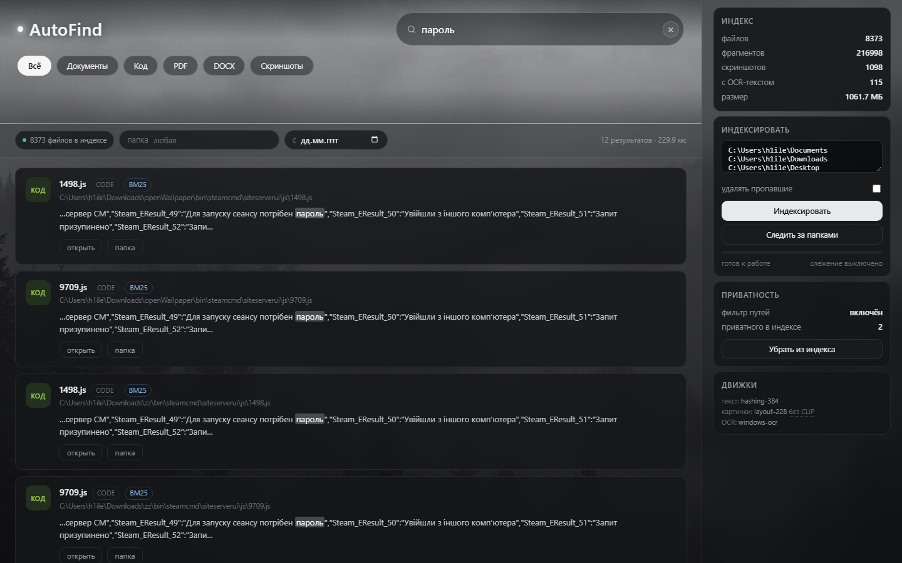
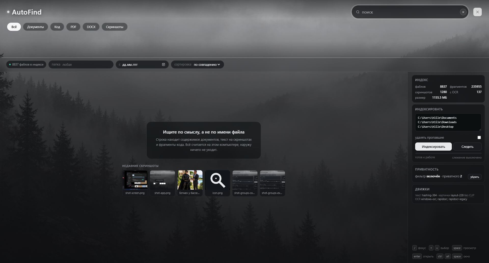

# SemFind / AutoFind

Local search over your files and screenshots. One SQLite file, no account, no
network calls at runtime.



The window is branded **AutoFind** — the folder the project lives in. The Python
package, the CLI and the index directory are still `semfind`; renaming those
would break every path in the docs for no functional gain.

The header follows the sketched layout: the forest photo (`web/fon.jpg`) as the
background, the wordmark top-left, the search field with a clear button
top-right, and the type filter as a row of pills directly under the title. The
photo is not confined to the header — it is the page background (fixed, `cover`),
with a single vertical veil over the whole window and translucent glass panels
on top, so results sit *on* the image and it shows through the gaps instead of
being cut off by a black list. The accent is white-grey: an orange button read as
a warning against fog.

## Status

All four layers of the plan are implemented and run on a stock Windows machine
with no model downloads:

| Layer | State | Engine |
|---|---|---|
| Text (PDF, DOCX, PPTX, XLSX, EPUB, ODT, RTF, TXT/MD, code) | works | built-in extractors, no deps |
| Screenshots: OCR | works | 3 tiers, 66 languages here: Windows packs → PP-OCRv6 multi → PP-OCRv5 per script |
| Screenshots: visual similarity | works | 228-dim layout/colour descriptor |
| Search | works | fuzzy names + BM25 + vectors, fused with RRF |
| Name search | works | in-memory name index, 1.7 ms at 100k names |
| Vectors | works | memory-mapped pack, ~40 ms warm, no 333 MB matrix |
| Result grouping | works | versions, identical copies and screenshot bursts, expandable |
| Query language | works | `type:`, `ext:`, `in:`, `modified:`, `size:`, `re:`, … |
| Natural language | works | deterministic RU/EN intent compiler with removable chips |
| Agent access | works | MCP over stdio **and** HTTP (`semfind connect`) |
| CJK screenshots | works | Japanese, Chinese and Korean read via RapidOCR, not just retried |
| Live updates | works | polling watcher, ~2 s debounce |
| Quality measurement | works | `eval` with Recall@10, MRR, ablation |
| Privacy filter | works | path blocklist + `.gitignore` parity, `privacy purge` |
| App | works | native window (WebView2), tray, `Ctrl+Alt+Space`, autostart |

Two upgrades are drop-in and change nothing else: `multilingual-e5-small` for
semantic text vectors, and `CLIP ViT-B/32` for text-to-image search. Until they
are present the text embedder is lexical (words + character 4-grams) and image
search is similarity-only, and the UI says so instead of pretending.

## Quick start

```bat
SemFind.bat
```

or

```bash
python run.py                 # opens the app window
python run.py --browser       # the same UI in a browser tab, if you prefer
```

`run.py` opens a real window: its own icon, its own title bar, and it stays in
the tray when you close it. `Ctrl+Alt+Space` brings it back from anywhere, and
launching it a second time raises the window that is already running instead of
starting a rival copy.

To make it permanent — start with Windows, in the tray, no console window:

```bash
semfind install               # autostart entry + desktop and Start Menu shortcuts
semfind autostart status      # what the login entry points at
semfind autostart off         # undo it
```

The login entry is one value under `HKCU\...\Run`, so it also appears in Task
Manager → Startup where it can be switched off like any other program. It runs
`pythonw.exe`, not `python.exe`: the console window is the difference between an
app and a script.

The sidebar lists the folders worth indexing (Documents, Downloads, Desktop,
Screenshots) — one click indexes them, progress is live, and results appear as
files are added.

Command line:

```bash
python -m core.cli index ~/Documents ~/Downloads ~/Pictures/Screenshots --prune
python -m core.cli watch ~/Documents ~/Downloads          # keep the index in sync
python -m core.cli search "неверный пароль при входе"
python -m core.cli search "cannot find module" --kind image
python -m core.cli search "скриншоты за прошлую неделю"   # natural language
python -m core.cli search 're:"TODO|FIXME" ext:py'        # query grammar
python -m core.cli search "смета" --sort newest -n 20 --offset 20
python -m core.cli mcp                                     # MCP server for AI agents
python -m core.cli cheat                                   # print the grammar
python -m core.cli eval tests/queries/labels_demo.json --ablate --verbose
python -m core.cli doctor                                  # environment + bundle budget
python -m core.cli privacy                                 # what the filter would skip
python -m core.cli privacy purge                           # drop it from the index
python -m core.cli stats
```

## Query language and natural language

Two ways to say the same thing. Explicit grammar is authoritative — if the query
already contains a `key:value`, the intent compiler leaves it alone.

| Syntax | Meaning |
|---|---|
| `type:pdf` | category (`image`, `doc`, `sheet`, `presentation`, `code`, `video`, `archive`) or an extension |
| `ext:rs` | exact extension |
| `in:"C:\Docs"` | only inside this folder (Windows paths keep their backslashes) |
| `path:src` | substring of the path |
| `modified:<7d` | changed within a window: `1h`, `7d`, `30d`, `7d..30d` |
| `size:>2mb` | `>`, `<` or `1mb..10mb` |
| `lang:python` | language family of the extension |
| `name:config` / `content:timeout` | match the filename / the contents only |
| `re:"TODO\|FIXME"` | regular expression over content |
| `-node_modules` | exclude a term or folder |
| `"exact phrase"` | phrase |
| `mode:exhaustive` | every match, path-sorted, no ranking |
| `sort:newest` | `newest`, `oldest`, `largest`, `name` |

Plain phrasing is compiled into the same grammar, locally, with no model:

| You type | It becomes |
|---|---|
| `скриншоты за прошлую неделю` | `type:image modified:<7d` |
| `самые большие файлы` | sort by size |
| `3 дня назад ошибка` | `ошибка modified:4d..3d` |
| `вчерашние документы` | `type:doc modified:1d..2d` |
| `pdf про индексы` | `индексы type:pdf` |
| `screenshots from last week` | `type:image modified:<7d` |

Every inference comes back as a chip above the results with the words that
produced it; clicking the chip removes those words and re-runs. Nothing is
rewritten silently, and an unrecognised phrase is searched literally.

## Agents (MCP)

```bash
python -m core.cli mcp        # JSON-RPC 2.0 over stdio, read-only
python -m core.cli connect    # write the client config for you
```

Tools: `search` (with cursor pagination), `read_snippet` (bounded),
`index_state`, `regex_search`, `similar_images`. Read-only by construction —
there is no tool that can open, move or modify anything.

Two transports, because the right one depends on the client:

| Transport | Endpoint | When |
|---|---|---|
| stdio | `semfind mcp` | Claude Desktop, Cursor — the client owns the process |
| HTTP | `POST http://127.0.0.1:8765/mcp` | sandboxed agents, remote tools, no process to spawn |

`semfind connect` writes the entry into `claude_desktop_config.json` or
`~/.cursor/mcp.json`, merging with the servers already there and keeping a
`.bak` of the file it changed. `--transport http` writes the URL form instead,
with a bearer token generated once into `~/.semfind/mcp_token`. `--write` is
required to actually touch a file; without it the command prints the diff, which
is what you want the first time.

```bash
semfind connect                      # show what would change, all clients found
semfind connect cursor --write       # edit one client
semfind connect --transport http --write
semfind connect print                # paste-ready JSON
```

## How it works

```
files ──► extractors ──┐
                       ├──► chunker ──► text embedder ──┐
screenshots ──► OCR ───┘                                ├──► index.db
                                                        │    FTS5 + vectors
screenshots ──► visual descriptor ──────────────────────┘
                                                             │
                              fuzzy names ─┐                 │
                                            ├─► RRF ─────────┘
                              BM25 ─────────┤
                              KNN  ─────────┘
```

Screenshots land in the same `chunks` table as documents, so one query returns
a PDF and a screenshot side by side. Each screenshot also gets a thumbnail and
a visual vector, which powers "similar screenshots" in the UI.

**Three channels, one ranking.** Fuzzy name matching (a 64-bit character bloom
rejects most of the corpus before the matcher runs, so `rdme` finds `README.md`),
BM25 over chunk text, and cosine over the chunk vectors. The fused score is
normalised to `[0, 1]` and then adjusted: exact name +0.20, name prefix +0.15,
smooth recency `0.10·e^(−age/7d)`, frecency `0.08·log1p(opens)·e^(−last/14d)` from
files you actually opened, and a depth penalty bounded at −0.10 so a file twelve
folders deep cannot win on path shape alone. Results are **per file**, not per
chunk: a document matching three times is one row with its best snippet.

**Storage.** One SQLite file in WAL mode: `files`, `chunks`, `chunks_fts`
(FTS5), `images`, `vectors`, `usage`, `meta`. Vectors are float32 blobs searched
by brute force in numpy — at 50k chunks that is a 77 MB matrix and single-digit
milliseconds, so an ANN index would be premature. `sqlite-vec` can replace
`Store.knn()` without touching callers.

**Indexing is incremental.** Unchanged files are skipped by size+mtime, moved
files by sha256. Screenshots are deduplicated by sha256 before OCR runs.
`.gitignore`, `.cursorignore` and `.semfindignore` are honoured during the walk,
so build output a repository already ignores never reaches the index.

**Live updates** (`watch`) poll the roots every 2 s instead of using inotify or
ReadDirectoryChanges: one stat per file is cheap, and polling survives network
shares and cloud-synced folders where native notifications are unreliable. A
file is read only after it has been quiet for a second, so a document being
saved is indexed once at the end. On start the watcher also drops index entries
whose files no longer exist — otherwise a file deleted while the app was closed
would stay searchable forever.

## The app



`core/app.py`. pywebview hosts the same HTML in a WebView2 window — the system's
own Chromium, so nothing is bundled and the CSS renders exactly as it does in a
browser. The server runs in the same process on loopback: one process, one
index, one vector cache. A second process would mean a second port and a second
copy of the pack open at once.

- **No title bar.** The window is frameless and sized to the desktop *work area*,
  so it stops above the taskbar instead of covering it — the clock and the tray
  icon this app hides in are down there. The Windows title bar is four buttons
  the UI already replaces: a ✕ in the header corner, wired to the pywebview
  bridge (`js_api`) rather than to `window.close()`. `--windowed` brings the
  frame, the saved geometry and a resizable edge back.
- **Close means hide.** The window goes to the tray; the index and the server
  stay warm, which is the point of a launcher. Quitting is explicit, in the tray
  menu. If the tray and the hotkey both failed to start, closing really closes —
  hiding with no way back would strand the process.
- **`Ctrl+Alt+Space`** shows and hides it from anywhere. `--hotkey` changes it,
  `--no-hotkey` removes it.
- **A second launch raises the first.** The running app writes its port to
  `~/.semfind/app.port` and answers `POST /api/focus`; the new process asks and
  exits. An instance lock (`msvcrt.locking`, released by the OS on crash) is what
  stops two windows with two ports in the first place.
- **The window remembers.** Size, position and maximised state live in
  `~/.semfind/window.json`, clamped to the current screen so a window from a
  bigger monitor cannot open half under the taskbar. Borderless mode ignores the
  file: its size is the work area, not a preference.
- **Dark title bar and the app icon** via `DwmSetWindowAttribute` and
  `WM_SETICON`, for the `--windowed` case. The WinForms host defaults to a light
  title bar above a near-black UI, which looks like a screenshot pasted into a
  form.

`tools/make_icon.py` draws `web/icon.png` and `web/icon.ico` (16–256 px), so the
icon is reproducible instead of a binary nobody can regenerate.

## Measured on this machine

Windows 11, Python 3.13, 4 cores, hashed-feature text embedder, Windows OCR:

| Corpus | Files | Chunks | Index time | Query (warm) |
|---|---|---|---|---|
| 6 screenshots + plan document + this repo | 36 | 174 | 0.7 s | 7–10 ms |
| Synthetic 1000-file mix (txt/py/docx) | 1 000 | 1 000 | 1.1 s | 8 ms |
| Real `~/Downloads` tree (Blender, SteamCMD, projects) | 8 373 | 216 998 | ~14 min | 21 ms |

OCR costs about **86 ms per screenshot** including preprocessing (6 screenshots
in 0.5 s). The 1 000-file run is 881 files/s against the plan's 10-minute
target, but that corpus is 1.5 MB total with one chunk per file — PDF-heavy
folders will be an order of magnitude slower, because extraction, not embedding,
is the bottleneck.

Two numbers the plan should have known:

- **Cold start used to cost 2.6 s** on the 217k-chunk index: the vector matrix
  (333 MB) was read from SQLite and stacked. It is now a memory-mapped pack —
  see the next section — so the first query after a restart costs the same as
  the second.
- **The index is 1.06 GB for 8.4k files**, plus a 320 MB pack. Most of it is
  float32 vectors, not text. Deduplicating identical chunks across the tree
  would cut it substantially.

## Scaling past 100k files

Three things used to grow with the corpus in a way that would have broken at
100k files. All three were replaced, and each number below is measured, not
estimated.

### Names live in memory, not in SQLite

`core/nameindex.py`. Every name, path and kind is loaded once into flat arrays
with a 63-bit character bloom, and the bloom prefilter is one vectorised AND over
the whole corpus. Literal-substring queries are answered by a single C-level
regex scan over a NUL-joined byte buffer, scored in numpy — so the cost tracks
the number of hits, not the size of the index.

| Names | Before (SQL scan) | Now, literal | Now, abbreviation |
|---|---|---|---|
| 8 000 | 35 ms | 0.2 ms | 1.7 ms |
| 100 000 | — | 1.7 ms | 19 ms (capped) |
| 1 000 000 | — | 20 ms | 45 ms (capped) |

The abbreviation tier is capped at 20k candidates, newest first, which is what
keeps it **bounded** instead of linear: a query over 1M names costs the same as
over 100k.

### Vectors are memory-mapped, not stacked

`core/vectors.py`. The 333 MB float32 matrix used to be read from SQLite and
copied into a numpy array at startup. It is now a packed side file
(`index.db.vec`) mapped into the process: no copy, no anonymous 333 MB, and the
pages stay in the OS cache across restarts.

| Backend | Cold start | Query, 217k chunks | Extra disk |
|---|---|---|---|
| numpy matrix (before) | 2 600 ms | 21 ms | — |
| sqlite-vec `vec0` | 0 ms | 90–255 ms | +333 MB |
| memory-mapped pack | ~0 ms | 40 ms | +320 MB |

`sqlite-vec` is implemented and available (`--vector-backend sqlite-vec`) but is
not the default: its exact KNN walks shadow rows one at a time and costs 4–12x
more per query than one matmul. The pack is a pure cache — `vectors` in SQLite
stays the source of truth, so deleting the file costs a rebuild, never data.

### Near-duplicates collapse

`core/group.py`. Two rows that say the same thing are one row with a badge:

- **versions** — `resume.docx`, `resume_v2.docx`, `resume-final.docx`,
  `resume (1).docx`, `итоговый_отчет_в2.docx` group by a normalised stem inside
  one folder. Conservative on purpose: merging two genuinely different documents
  is worse than missing a merge, so `report` and `report_2024` stay apart.
- **copies** — the same file copied into two folders is one row. Same name and
  same sha256, different path: `openWallpaper\...\steambootstrapper_russian.txt`
  and `zz\...\steambootstrapper_russian.txt` are one answer, not two. Same
  bytes under a *different* name stay separate, because a name is usually the
  reason the user kept the second copy. On this corpus that is 611 rows (7%)
  that used to be noise.
- **bursts** — screenshots of the same screen within 15 minutes, in the same
  folder, at the **same pixel size**, within 10 bits of a 63-bit dHash **and**
  sharing 60% of their OCR words. Every one of those conditions comes from a
  false positive on real data: dHash resizes to 9×8 first, so it is blind to
  scale and scored one icon exported at 30, 44, 71 and 1024 px as identical.
  Hence the size floor (640 px — a screenshot is a screen, not a 32×32 sprite
  frame) and, when neither side has OCR text to confirm the match, a near-exact
  hash (≤2 bits). A wrong merge hides a file; a missed one leaves an extra row.

Clicking the badge expands the group. The badge is a fact, not decoration: it
tells you the row you see is the one the ranker picked out of N.

Bursts need a perceptual hash, which arrived in schema v4. An index built by an
older version gets it backfilled at the end of `semfind index` — decode only, no
OCR, 1 097 images in 3.8 s here. Without it the detector would silently see no
hashes on exactly the screenshots that were indexed first, since an unchanged
file is never re-indexed.

## Quality

`semfind eval` scores a labelled query set. On the 14-query smoke set over the
8.4k-file corpus:

| Channel | Recall@10 | MRR | p95 |
|---|---|---|---|
| BM25 only | 0.714 | 0.620 | 22 ms |
| Vector only (hashing fallback) | 0.071 | 0.073 | 39 ms |
| Fused (shipped default) | 0.714 | 0.620 | 59 ms |

Read this as a diagnosis, not a score. With the fallback embedder the vector
channel adds nothing and, at equal weight, actively hurt (0.643 recall before
damping). Two changes came out of the measurement: the vector weight now comes
from the embedder itself (0.3 for the hashed fallback, 1.0 for a semantic
model), and a query with no lexical match returns nothing instead of hash
collisions. The remaining misses are all paraphrases — «ошибка сборки» for a
screenshot that says `Error: cannot find module` — which is precisely what e5 is
for, and exactly what this build cannot do.

The 20-query acceptance set from the plan is in `tests/queries/queries.json`;
labels are still placeholders. Recall@10 ≥ 0.7 stays unproven until someone runs
it on a real corpus with answers written by a second person.

## OCR notes

The Windows recogniser ships with the OS and knows Russian if the language pack
is installed — no Tesseract binary, no 20 MB of traineddata, no install step.

Preprocessing is engine-specific, and this was measured rather than assumed:
feeding a dark screenshot through grayscale + autocontrast **lowers** the
Windows engine's output (136 vs 162 characters on the same image), because it
handles dark themes natively. So it gets the image as-is plus an upscale for
small text; only Tesseract gets the grayscale-and-invert treatment.

Engine order: `windows-ocr` → `tesseract-cli` → `pytesseract` → `rapidocr`.
The engine that produced a screenshot's text is recorded in the index, so a
later switch is visible instead of silent.

**66 languages.** Three tiers, and the order is the design:

| Tier | Engine | Languages | Cost |
|---|---|---|---|
| 1 | Windows OCR, *every* installed pack | `ru`, `en-US` here | 6–60 ms |
| 2 | rapidocr PP-OCRv6 `multi` | 53: all Latin-script, Japanese, Chinese | ~1.9 s |
| 3 | rapidocr PP-OCRv5 per script | Korean, Arabic, Cyrillic, Devanagari, Greek, Thai, Tamil, Telugu | ~1.2 s each |

Tier 1 tries every installed language pack rather than the display language: on
this machine `en-US` reads Russian as `npl'1BeT` and the `ru` pack reads it
correctly, for the same 10 ms. Tiers 2 and 3 only run when the result is
implausibly small for the amount of ink in the image — the same measured gate as
before — so a Russian screenshot costs 10 ms and a Japanese one costs 2 s
instead of being indexed as stray Latin letters.

Measured end to end on rendered test images:

| Image | Engine that won | Time | Text |
|---|---|---|---|
| English | `windows-ocr` | 0.01 s | exact |
| Russian | `windows-ocr` (`ru`) | 0.01 s | exact |
| Chinese | `rapidocr:multi` | 2.0 s | `你好世界 中文测试` |
| Japanese | `rapidocr:multi` | 3.4 s | `こんにちは世界 日本語のテスト` |
| Korean | `rapidocr:korean` | 5.3 s | `세계 … 테스트` |
| Arabic | `rapidocr:arabic` | 7.2 s | Arabic script, partially correct |

The tail is expensive on purpose, and bounded in two ways. Models that are not
on disk are never downloaded in the middle of an index run — `semfind ocr
download all` fetches them once (9 models, 70 MB). And the chain switches itself
off after eight consecutive attempts that changed nothing, so a folder of
photographs stops paying for the fallback after ~10 s while a folder of Japanese
screenshots — where every attempt succeeds — never hits the limit.

`semfind ocr languages` prints the languages readable *right now* with their
greetings; `semfind doctor` prints the count, the models on disk and the
installed packs. `ocr_cjk_model` still pins a custom recognition model.

## Cold start

`tools/coldstart.py` spawns the real app and polls until the index is warm,
timing three separate milestones. Three runs, median:

| Milestone | Median | What it means |
|---|---|---|
| port answers | 0.65 s | Python is up, the server thread is running |
| index ready | 0.77 s | vector pack faulted in — `/api/ready` flips |
| window visible | 0.96 s | a borderless window titled AutoFind is on screen |
| first search | 148 ms | one query against the now-warm index |

The gap between "port answers" and "index ready" is 120–160 ms of prewarm; the
rest is interpreter start plus `import webview`, which no amount of our own
optimisation removes. The gap between "index ready" and "window visible" is
WebView2 painting its first frame.

A true cold start also needs the OS page cache dropped, which needs
administrator rights; this measures a start with the index on disk and a
lukewarm file cache. The median of several runs is the number to quote.

## The boot screen


Because the window paints ~190 ms after the index is already warm, the splash is
not covering a slow load — it exists so the first thing on screen is not an
empty grid. It shows one greeting, changing every 700 ms, drawn from the
languages this machine's OCR can actually read: **the languages on screen are
exactly the ones the index can find text in.** On this machine that is 66 of
them, so the greeting is as likely to be `こんにちは` or `안녕하세요` as `Hello`.

It is bounded at both ends — minimum 900 ms so it never flashes, maximum 8 s of
polling so it can never hang — and Escape or a click dismisses it. A deep link
(`?q=` or `?preview=`) skips it: a link to a file is not a request for a
greeting.


## Embedders

| Role | Default | Upgrade |
|---|---|---|
| Text | `hashing-384` (words + char 4-grams) | `e5-small` int8 ONNX |
| Visual | `layout-228` (colour, layout, edges) | `CLIP ViT-B/32` int8 ONNX |

Drop weights in and restart:

```
~/.semfind/models/e5-small/model.onnx + tokenizer.json
~/.semfind/models/clip/visual.onnx + textual.onnx + tokenizer.json
```

`pip install 'semfind[onnx]'` adds the runtime. The index records which embedder
built it and refuses to mix two, so switching means reindexing — deliberate, not
an oversight.

## Bundle budget

`semfind doctor` adds up what would actually ship:

```
bundle       378.0 MB of 150 MB budget  over by 228.0 MB
  python-embed                  15.0 MB   runtime
  numpy                         18.0 MB   runtime
  pillow                         4.0 MB   runtime
  winrt bindings                 3.0 MB   runtime
  onnxruntime                   50.0 MB   optional: only with e5/CLIP
  app code + web                 1.0 MB   runtime
  model:e5-small               120.0 MB   download or bundle
  model:clip-vit-b32            45.0 MB   download or bundle
  model:tesseract-rus-eng       22.0 MB   download or bundle
  model:argos-ru-en            100.0 MB   download or bundle
```

The plan's ≤150 MB installer cannot hold e5 + CLIP + Argos. Dropping Argos
(Russian queries would then need a multilingual CLIP export, or text-to-image
search stays English-only) saves 100 MB and still leaves 278 MB. The realistic
split is a ~60 MB shell plus models downloaded on first run, or a hard choice
between semantic text and text-to-image.

## Privacy

Two separate promises, and the second one was missing:

1. **Nothing leaves the machine.** No network calls at runtime; the HTTP server
   binds to 127.0.0.1 and rejects foreign Host headers.
2. **Some things never enter the index.** `core/privacy.py` drops password
   stores, key material, browser profile data and cloud-credential folders
   *before* any file is opened: `.ssh`, `*.kdbx`, `wallet.dat`, Chrome/Edge
   profile directories, `*.env`, `*password*`-style names. Source files are
   exempt from the broad name globs — Blender ships `secrets.py`, and indexing a
   standard-library module is not an incident.

The filter is on by default, its count appears in `index` output and in the UI,
and `semfind privacy purge` removes what slipped in earlier. On this machine it
found two «Пароль на архив» files that predate the filter.

Still missing: **the index is not encrypted**. Filtered paths are skipped, but
everything else — including OCR text of your entire screen — sits in a plain
SQLite file. An app-level blocklist, a pause switch and SQLCipher are open items.

## Tests

```bash
python -m unittest discover -s tests -t .
```

178 tests: chunking, kind detection, DOCX/PDF/PPTX/XLSX/EPUB/ODT/RTF extraction,
image preprocessing, visual features, thumbnails, real OCR including Japanese
(skipped when no engine), the language table and the boot screen's greeting
pool, `/api/ready`, FTS query sanitising, the full index→search cycle, kind filters,
incremental skips, screenshot dedup, similar-image search, the privacy
blocklist, `.gitignore` parity, watcher diffing and startup cleanup, the eval
metrics, the bundle estimate, the query grammar and intent compiler, fuzzy name
scoring, the ranking bonuses, pagination, the MCP surface, the name index, the
vector pack, grouping and the desktop-app plumbing (lock, geometry, autostart).

`tests/queries/queries.json` holds the fixed 20-query acceptance set from the
plan. Expected answers are still placeholders — attaching a real corpus is what
turns Recall@10 from a claim into a number.

## Not done yet

- `CLIP` and `e5` weights are not bundled; the installer budget is 378 MB
  against the plan's 150 MB, and that decision is still open.
- Index encryption, an app blocklist and a global OCR pause switch.
- A signed installer: the app window, tray, hotkey and shortcuts exist, but
  there is no MSI and no code signing yet, so "install" is a command rather than
  a wizard.
- Facet counts are computed for filter-only queries, not for ranked ones — the
  candidate pool is bounded, so the number would be a lie.
- OCR covers 66 languages on this machine; the rest of rapidocr's table
  (Hebrew, Bengali, Georgian, Armenian) needs a Windows language pack, which
  only the OS installer can add.
- Cold start is 0.77 s to a warm index, of which ~0.65 s is interpreter start
  and `import webview`. Getting under that needs a packaged binary, not faster
  Python.
- The document itself still has the inconsistencies listed in the review
  (top-10 table vs figure, p95 vs median, 30 Nov vs 29 Nov).

Closed since the kensaku comparison: the name index (1.7 ms at 100k instead of a
35 ms scan at 8k), the vector matrix (a memory-mapped pack: ~40 ms warm, ~0 ms
cold, no 333 MB allocation), version grouping, identical copies and screenshot
bursts, MCP over HTTP with `semfind connect`, OCR in 66 languages, cold start
under a second, and the launcher — a borderless window over the taskbar, a tray
icon, a global summon key and a login entry.

## License

MIT.
